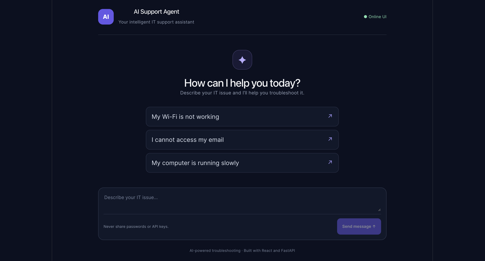

# AI Support Agent

An AI-powered IT support assistant built with **FastAPI, Python, React, TypeScript, and the OpenAI API**. The application analyzes IT support requests, classifies issues into predefined categories, and generates practical troubleshooting guidance through a web-based chat interface.

## Live Demo

**Try the application:** [AI Support Agent](https://ai-support-agent-313288084160.europe-north1.run.app)

An AI-powered IT support assistant that classifies support requests and generates helpful responses using OpenAI.

## Screenshot



## Tech Stack

- **Frontend:** React, TypeScript, Vite
- **Backend:** Python, FastAPI
- **AI:** OpenAI API with structured output for support classification
- **Testing:** Pytest
- **Containerization:** Docker
- **Cloud deployment:** Google Cloud Run
- **Secrets management:** Google Cloud Secret Manager
- **API documentation:** Swagger UI / OpenAPI

## Features

- Accepts IT support requests through a web interface
- Classifies requests into categories such as email, network, performance, account, and general
- Generates AI-powered support responses
- Validates incoming requests using Pydantic
- Handles AI service errors with appropriate HTTP responses
- Includes automated backend tests
- Serves the React frontend and FastAPI backend from a single deployed service

## Features

- **AI-powered troubleshooting:** Generates contextual, step-by-step guidance for IT support requests.
- **Automatic categorization:** Classifies issues as email, network, performance, account, or general.
- **Web-based chat interface:** Interactive frontend built with React and TypeScript.
- **Markdown rendering:** Formats AI responses with readable lists and headings.
- **Input validation:** Validates requests using Pydantic.
- **Error handling:** Returns a generic error message when the AI service fails.
- **REST API:** Exposes support functionality through FastAPI.
- **Automated testing:** Tests API behavior and failure scenarios without making real OpenAI API calls.
- **Continuous integration:** GitHub Actions runs automated tests on pushes and pull requests targeting `main`.

## Tech Stack

**Backend**

- Python 3.11+
- FastAPI
- OpenAI API
- Pydantic
- Uvicorn
- Pytest and HTTPX

**Frontend**

- React
- TypeScript
- Vite
- React Markdown
- CSS

**Development**

- Git and GitHub
- GitHub Actions

## Architecture

```text
User
 |
 v
React + TypeScript frontend
 |
 | HTTP POST /support
 v
FastAPI backend
 |
 | Structured AI request
 v
OpenAI API
 |
 v
Categorized troubleshooting response
 |
 v
Frontend renders the response
```

## Getting Started

### Prerequisites

- Python 3.11 or newer
- Node.js and npm
- An OpenAI API key with available API credits

### 1. Clone the repository

```bash
git clone https://github.com/moa23/ai-support-agent.git
cd ai-support-agent
```

### 2. Set up the backend

Create and activate a virtual environment:

```bash
python3 -m venv .venv
source .venv/bin/activate
```

Install the Python dependencies:

```bash
python -m pip install -r requirements.txt
```

Create a `.env` file in the project root:

```env
OPENAI_API_KEY=your_api_key_here
```

Replace the placeholder with your own API key.

### 3. Start the backend

From the project root, run:

```bash
uvicorn main:app --reload
```

The backend will be available at:

- API: http://127.0.0.1:8000
- Interactive API documentation: http://127.0.0.1:8000/docs

Keep this terminal running.

### 4. Set up the frontend

Open a second terminal and run:

```bash
cd frontend
npm install
npm run dev
```

Open the local URL printed by Vite, usually:

http://localhost:5173

The frontend communicates with the local FastAPI backend at `http://localhost:8000`.

## API Usage

### `POST /support`

Submit an IT support request.

Example request:

```json
{
  "message": "I cannot connect to the Wi-Fi."
}
```

Example response:

```json
{
  "message": "I cannot connect to the Wi-Fi.",
  "response": "1. Check that Wi-Fi is enabled. 2. Verify that you are connected to the correct network.",
  "category": "network"
}
```

The response is generated by the AI and may vary between requests.

### Support categories

| Category      | Example                               |
| ------------- | ------------------------------------- |
| `email`       | Problems sending or receiving email   |
| `network`     | Wi-Fi or internet connectivity issues |
| `performance` | A slow computer or application        |
| `account`     | Login or account access problems      |
| `general`     | Other IT support requests             |

## Running Tests

Activate the Python virtual environment from the project root, then run:

```bash
python -m pytest -v
```

The test suite mocks OpenAI API calls, so tests do not consume API credits.

## Production Build

To verify the frontend production build:

```bash
cd frontend
npm run build
```

The generated production files are written to `frontend/dist/`.

## Security Notes

- Keep API keys in environment variables.
- Never commit `.env` files or expose secrets in source control.
- The frontend is configured for local development. Review CORS settings and add appropriate authentication, rate limiting, and monitoring before deploying publicly.
- Do not submit passwords, API keys, or other sensitive information through the support chat.

## Future Improvements

- Add conversation history and contextual follow-up questions.
- Introduce rate limiting and monitoring.
- Improve accessibility and frontend error feedback.
- Add integration and end-to-end tests.
- Deploy the application to a cloud platform.

## Project Status

An actively developed portfolio project demonstrating practical AI integration, REST API development, automated testing, and frontend-backend integration.

## Run Locally

### Prerequisites

- Python 3.11+
- Node.js and npm
- An OpenAI API key

### 1. Clone the repository

```bash
git clone https://github.com/moa23/ai-support-agent.git
cd ai-support-agent
```

### 2. Configure the backend

Create and activate a Python virtual environment:

```bash
python3 -m venv .venv
source .venv/bin/activate
```

Install the backend dependencies:

```bash
pip install -r requirements-prod.txt
```

Create a `.env` file in the project root and add your own API key:

```env
OPENAI_API_KEY=your-api-key-here
```

Never commit your `.env` file or expose your API key.

### 3. Start the backend

```bash
uvicorn main:app --reload
```

The API will be available at `http://127.0.0.1:8000`.

API documentation: `http://127.0.0.1:8000/docs`

### 4. Start the frontend

Open a second terminal:

```bash
cd frontend
npm ci
npm run dev
```

Open `http://localhost:5173` in your browser.

### 5. Run the tests

From the project root, activate the virtual environment and run:

```bash
pytest -v
```
